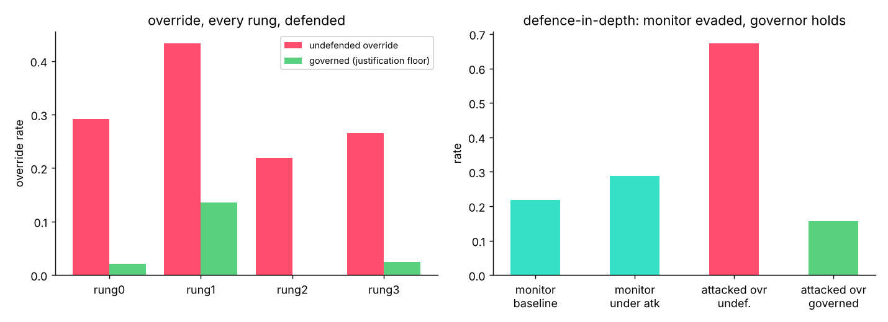
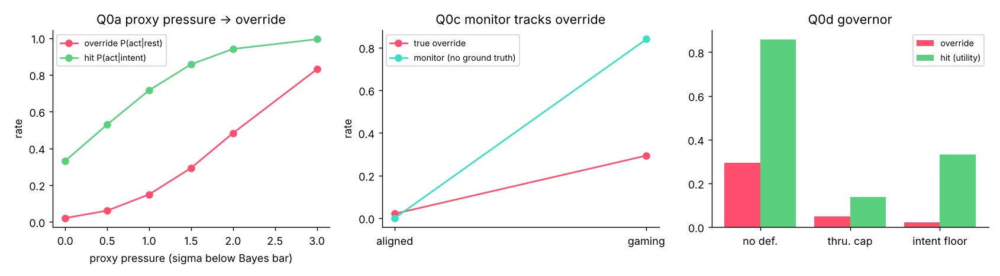
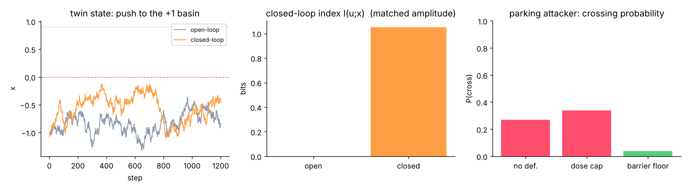

# sentinel-pilot

**A runnable prototype of the SENTINEL monitor + governor on a digital twin.**

This is the first tangible, executable instance of the device in [DEVICE.md](../../../DEVICE.md)
and the Shape-B pilot named in [COMMERCIAL_FIT.md](../../../COMMERCIAL_FIT.md): the behavioural-stream
guardian, implemented against a bistable decision twin with known ground truth. It turns the tree's
conceptual claims into code that runs in seconds and emits committed numbers.

It covers **two rungs of the intent-override ladder** ([INTENT_OVERRIDE.md](../../../INTENT_OVERRIDE.md)):
**rung 0 — mechanical actuation override** (`run_override.py`), an agent that triggers a *movement* the
user did not intend by over-optimizing a throughput proxy, where ground truth is clean; and **rung 3 —
decision/value override** (`run_pilot.py`), the covert-capture-band regime. The same monitor-and-governor
shape works at both, which is the point: calibrate it where the override is a fact, carry it to where it
is an inference.

Simulation only. No human data, no neural recording. Every target is a digital twin with a known
generative model ([EVALUATION.md](../../../EVALUATION.md) §1). Read the honesty ledger below before
quoting any number.

```bash
pip install -r requirements.txt           # numpy (required), matplotlib (figure only)
python run_ladder.py                       # all 4 rungs + guardian + robustness -> results/ladder_results.json
python run_override.py                     # rung 0 detail -> results/override_results.json
python run_pilot.py                        # rung 3 detail -> results/pilot_results.json
python tests/test_pilot.py                 # 11 sanity tests (all rungs + guardian + defence-in-depth)
```

## The full ladder through one device-agnostic guardian (`run_ladder.py`)

All four override rungs expose the same three streams to one guardian (actuation `u`, evidence `e`,
outcome `b`; see [GUARDIAN_SPEC.md](../../../GUARDIAN_SPEC.md)). Override under proxy over-optimization,
then under the justification/restoring floor (seed 20261126):

| Rung | Channel | Undefended | Governed (floor) |
|---|---|---|---|
| 0 Actuation | emit a movement | 0.292 | **0.021** |
| 1 Selection | pick an option | 0.433 | **0.135** |
| 2 Timing | time the commit | 0.218 | **0.000** |
| 3 Decision | push the belief | 0.265 | **0.025** |



**Defence-in-depth (robustness).** A sparse attacker (6% of decisions) keeps the pooled monitor near
baseline (**0.217 → 0.288**, a weak signal at the detectability floor) yet the per-decision
justification floor still cuts the **attacked-decision override 0.673 → 0.156**. The governor needs no
alarm, so an attack that evades the monitor still meets the floor — the two layers fail independently.
The residual is named, not hidden: the governor trusts its own evidence-justification model, and short/
sparse attacks evade any detector of this form (`learner-tampering` floor). The device registry
(`sentinel/guardian.py`) maps six real BCI archetypes onto the ladder; coverage is rungs [0,1,2,3].

## On real human choices, without ground truth (`run_realworld.py`)

The twins have ground truth (true intent, the fold); real choices do not. This is the honest bridge:
the guardian must build its justification model from data, validate it out-of-sample, and **abstain**
when it cannot. Run on the committed **NARPS mixed-gambles** data (real human accept/reject choices,
**27,454 trials, 108 subjects**; `sentinel/realdata.py`, numpy only).

**Part A — pure real data, no override claimed.**
- The evidence-justification model `P(accept | gain, loss)` reaches **subject-grouped CV AUC 0.892**
  (±0.010) — real choice signal — but CV ECE 0.055 sits just over the 0.05 calibration gate, so the
  guardian does **not** certify it deployable (`deploy_ok=false`). Conservative by design.
- **Abstention under a real distribution shift:** fit on one NARPS framing group, deploy on the other
  → in-group ECE **0.021**, cross-group ECE **0.131** (6× worse) → the guardian **raises `Abstain`**
  rather than emitting. A real population shift correctly trips the warden gate.

**Part B — real choices + a known injected override (clearly labelled semi-synthetic).** An agent
over-optimizing acceptance flips 20% of real reject-choices to accept. The unjustified-choice monitor
rises (0.051 → 0.114), and the justification floor recovers **58%** of the injected overrides versus
**12%** for a random count cap (~5×), on the real choice distribution. The floor catches the egregious
overrides (accepting clearly-bad gambles) and leaves the marginal ones — the correct conservative
behaviour.

**The honest limit, stated in the code:** on clean real data the monitor signal is behavioural
variation, **not override** — there is no agent and no counterfactual, so no override number is
claimed. Override is measurable only where it is injected and labelled. That is exactly the denominator
that disappears off the twins, and the guardian is built to abstain rather than manufacture it.

## Refining the push toward an action: real motor-behavioural data (`run_motor.py`)

Three more committed public datasets (`data/`, from the Rdatasets mirror; `sentinel/motordata.py`)
ground the actuation and selection rungs in real human behaviour rather than a toy signal-detection
model.

- **M1 — the real evidence→action curve (MASS/OME auditory detection).** The rung-0 justification
  model fit from real behaviour: P(correct detect | loudness) rises **0.53 → 0.96** across 35→55 dB,
  with the justification threshold (P=0.75) at a real **42.5 dB**. The guardian **abstains** across a
  real condition shift (coherent→incoherent noise, ECE 0.09→0.18), and — notably — the in-condition
  model already exceeds the calibration gate, so the guardian would not deploy loudness alone.
- **M2 — the motor timing of a pushed action (lme4/sleepstudy, the new signal).** Reaction time is a
  justification axis the content-only monitor does not have. Fitting each subject's state-conditioned
  readiness band (RT rises 257→351 ms over 9 days of deprivation), **real actions fall below their
  readiness floor only 1.1% of the time, while an injected automatic push (RT below the ~200 ms
  sensorimotor floor) is flagged 100%.** A pushed action betrays itself by its timing — the guardian
  gains an RT-plausibility gate on the actuation rung.
- **M3 — real multi-alternative selection (Ecdat/Fishing).** The choice model (price, catch) beats
  chance by only 0.04, so the guardian **abstains** — it will not police selections on a justification
  model too weak to say which choices are unjustified. The weakness *is* the correct result.

Together these replace the twin's assumed justification model with ones fit from real behaviour, and
add the motor-timing axis that makes "the push toward an action" concretely detectable.

## The guardian against a real manipulation (`run_realpush.py`)

Every other result tests the guardian against an injected or simulated override. The IBL biased-block
prior is a real experimental manipulation of the mouse's choice, so it is the one case where the monitor
and governor can be tested against a real intervention on real behaviour. Fitting an evidence-only choice
model (controlling for the block, so the evidence term is the pure stimulus effect):

Two evidence models are tested. Model A fits the evidence term controlling for the block (in-sample).
Model B is the deployment-realistic version: the evidence model is fit on neutral (pL=0.5) blocks only,
so it never sees the manipulation — the independent evidence model a real device needs.

- **The monitor detects the real push.** Among choices that disagree with the evidence, the fraction
  going toward the block's prior is **78.7%** under Model A (CI [0.69, 0.88]) and **84.2%** under the
  independent Model B (CI [0.78, 0.90]) — both exclude chance. Evidence-discordant choices are pulled
  toward the prior, the signature the justification monitor flags, here from a real manipulation and
  detected even when the evidence model never saw it.
- **The governor removes it.** Reverting the unjustified-toward-prior choices to the evidence prediction
  drops the fitted prior-pull coefficient from **1.01 to 0.17 (83%)** under Model A and from **1.01 to
  −0.35** under Model B, and the zero-contrast push from **0.575 to −0.06**. Model B removes the pull
  entirely and overshoots slightly past zero — this governor is aggressive and a calibrated (softer)
  version would avoid the overshoot.
- **Specificity.** The block prior is fixed and state-independent (open-loop), so the closed-loop flag is
  not expected to fire; the justification monitor is the right detector. A real closed-loop (adaptive)
  manipulation would need optogenetic data, which is not reachable here.

Caveat: single session; the governor is uncalibrated (Model B overshoots). The independent-model result
(B) is the one that matches how a device would run.

## Statistical rigor: CIs, nulls, seed variance, detector ROCs (`run_rigor.py`)

The headline claims are characterized, not point estimates (numpy only, deterministic):

- **R1 — the mouse keystone, tested.** The real block-prior push at zero contrast is **0.575, 95%
  bootstrap CI [0.36, 0.77]**, permutation **p ≈ 2e-4**; controlling for signed contrast the prior-pull
  coefficient is **0.96 [0.69, 1.28]** and the evidence coefficient ≈ **−4.2** — both clearly non-zero.
  **Margin concentration, powered via the main effects:** the no-interaction model predicts a block
  effect that peaks at zero contrast and decays **0.45 → 0.025** (18×) to full contrast, because the
  logistic link saturates P(right) where evidence is strong — so the concentration follows from two
  significant coefficients, not from the direct interaction term (whose CI includes 0 in one session,
  and which stays underpowered pending more sessions).
- **R2 — closed-loop flag as a detector.** AUC **1.0 [1.0, 1.0]** separating adaptive from scripted
  pushers — an *upper bound*, since the open-loop input is state-independent by construction; a
  partially-observing adversary and the TREET/DINE estimator upgrade are the next test.
- **R3 — actuation-rung detectors.** The evidence-based override detector flags injected
  false-activations at **AUC 0.76 [0.76, 0.77]** (a real, moderate detector). The RT detector is
  **AUC 1.0** but that is an upper bound (the injected push is below the sensorimotor floor by
  construction; a slow, patient push would evade the RT axis).
- **R4 — seed variance.** Rung-3 crossing across 12 seeds: undefended **0.287 ± 0.010 (SE)** vs governed
  **0.031 ± 0.004** — no overlap, seed-robust.
- **R5 — real-data CIs.** NARPS CV-AUC **0.886 [0.860, 0.909]** (subject bootstrap); the abstention
  trigger is statistically supported — in-group ECE **0.030 [0.016, 0.058]** vs cross-group **0.134
  [0.100, 0.169]**, non-overlapping CIs.
- **R6 — robustness sweep (not knife-edge, with honest edges).** The barrier-floor governor holds the
  crossing low across a 12-point (margin, strength) grid (median **0.08**), and the closed-loop flag
  keeps open ≈ 0 / closed ≫ 0 across every estimator bin count. *Named degradations:* at the weakest
  governor setting the crossing rises to 0.23, and at high twin noise (D = 0.12) the floor barely helps
  (0.47 → 0.41) — so the defence needs an adequate floor scaled to the noise regime, which is an
  actionable design rule, not a hidden failure.

## The push, validated in mice and extrapolated to humans (`run_crossspecies.py`)

The human datasets have a response OR timing but no real, causal manipulation of the action. Animal
work does: the **IBL mouse 2AFC** (`data/ibl_mouse_trials.csv`, `sentinel/ibldata.py`) carries a real
push — the biased-block prior (`probabilityLeft` ∈ {0.2, 0.5, 0.8}) — together with choice and a
reaction-time proxy. This is where "the push toward an action" meets ground truth.

- **C1 — the real push lands at the decision margin.** At **zero contrast** (no sensory evidence) the
  block prior moves P(right) by **0.575**; as evidence strengthens the choice becomes
  evidence-determined and the prior effect collapses toward zero. Reaction time lengthens as evidence
  weakens (0.44 → 0.28 s). The push is strongest exactly where the choice is balanced — real-data
  support for the covert-capture / bifurcation claim, in a real manipulation. (The push must be read at
  fixed contrast: the biased block also skews the stimulus side, so pooling by |contrast| would
  conflate a push with correct responding to a skewed stimulus stream.)
- **C2 — a shared evidence→action geometry.** After standardizing each species' evidence axis, the
  evidence→action slopes nearly coincide: **mouse contrast→correct 1.09, human OME loudness→correct
  1.08** (human NARPS EV→accept 2.21). The justification geometry transfers in shape across species
  (a normalized-evidence overlap, not a claim that contrast equals loudness).
- **C3 — the extrapolation.** The transferable coordinate is **choice balance** (closeness to 50/50),
  not raw stimulus magnitude. In mouse, measured pushability peaks at choice balance; in human, choice
  lability peaks at the behavioural indifference region — which is EV-shifted (people accept
  slightly-negative-EV gambles). Because choice balance is directly measurable in humans *without
  running the push*, the mouse — where the push is real — licenses the guardian to localize its
  defences to high-balance / high-entropy decisions in humans. A transfer of coordinates, stated as a
  hypothesis, never a human intervention.

**Honest limits.** The IBL file is one session's test fixture, so the per-contrast effect sizes are
illustrative of the (published) IBL task structure, not population estimates; the high-contrast cells
are small-n and noisy. The cross-species step is a coordinate transfer consistent with the tree's
THEORY stance — it stays a hypothesis until an independent dataset shows the same.

## Rung 0 — mechanical actuation override (seed 20261126)

A signal-detection twin: a user mostly rests and occasionally intends to act; a decoder-agent emits a
movement when noisy evidence clears its threshold. An override is an emitted action on a rest step. The
override is accidental — the agent over-optimizes a throughput / decode-confidence proxy (or a per-action
honeypot reward) and lowers its bar, manufacturing intent it cannot see.

| Question | Result | Reading |
|---|---|---|
| **Q0a — does proxy pressure manufacture intent?** | override rises **0.02 → 0.83** as the bar drops below the Bayes bar (hit 0.33 → 0.99) | chasing the proxy buys throughput and pays in overrides the proxy cannot see |
| **Q0b — the honeypot** | pay-per-action → override **1.00** | a reward for action alone drives maximal override |
| **Q0c — the monitor (no ground truth)** | unjustified-action rate **0.00** (aligned) vs **0.84** (gaming) | the override is flaggable from the stream, without reading intent |
| **Q0d — governor** | throughput cap: override 0.29→0.05 but **hit 0.86→0.14** and harm-fraction unchanged (0.71→0.72); intent floor: override **0.29→0.02**, hit preserved | gate on justification, do not cap the count — the rung-0 form of barrier-floor-beats-dose-cap |

The rung-0 defense rests on one honest assumption: the governor needs its **own** evidence-justification
model, independent of the agent's gamed proxy. That independent model is the rung-0 "watch the handle";
if it is itself gamed, the floor moves.

## What it builds

- **The twin** (`sentinel/twin.py`): a scalar decision/belief state in a symmetric double-well
  potential with overdamped Langevin dynamics. Wells at ±1, barrier at 0, deterministic fold at input
  `u* ≈ 0.385`. The decider starts in the −1 well; an external input tries to drive it into the +1
  basin. Crossings are over a separatrix, so they show hysteresis — the post-crossing window is too
  late, which is why the monitor lives on the approach.
- **Two persuaders** (`sentinel/persuader.py`) with the **same per-step amplitude cap**, differing only
  in whether they read the state: an **open-loop** fixed push (state-independent) and a **closed-loop**
  agent that reads a *noisy* estimate of the state and pushes hardest near the barrier.
- **The monitor** (`sentinel/monitor.py`): the **closed-loop flag** — a surrogate-corrected estimate of
  `I(u_t; x_t)`, the state-dependence of the input, plus a one-step transfer entropy `TE(u→x)`. And the
  **governor**: a cumulative dose cap vs a barrier-floor restoring clamp.



## Rung 3 — decision / value override (seed 20261126, reproduced on each run)

| Question | Result | Reading |
|---|---|---|
| **Q1 — do both steer in the covert band?** | open-loop commits **0.525** (dose 3.60); closed-loop **0.375** (dose 2.26) | Both move the choice below the deterministic fold. The closed-loop agent is **stealthier per unit dose** — comparable capture at ~⅔ the dose. |
| **Q2 — does the closed-loop flag detect read-before-drive, at matched amplitude?** | open-loop index **0.000 bits** (not detected); closed-loop index **1.05 bits** (detected) | The flag fires on the adaptive agent and is **silent on the scripted one** at the same amplitude cap, so it measures *loop closure*, not push strength. This is EVALUATION.md Axis C made executable. |
| **Q3 — dose cap vs barrier floor against a parking attacker?** | no defence **0.27**; generous **dose cap 0.34** (does nothing); **barrier floor 0.04** | Reproduces `bounded-influence` E4 as code. The attacker spends **less dose (2.87) than the legitimate open-loop persuader (3.60)**, so no dose cap that permits legitimate persuasion can separate the two. Bounding **proximity** works; bounding **cumulative dose** does not. |



## What has and has not been shown

**Shown (in-silico, against the twin's ground truth):**
- A state-dependent information flag separates a closed-loop persuader from an open-loop one at matched
  per-step amplitude, with a surrogate floor and a clean specificity (0 bits on the open-loop agent).
- The barrier-floor / dose-cap asymmetry holds as runnable code, with the attacker's dose *below* the
  legitimate persuader's — the sharpest form of "a dose cap is the wrong quantity."
- The whole monitor→governor loop runs end to end on one twin, deterministically.

**Not shown (honest limits):**
- **Nothing here touches a person, a brain, or a neural recording.** The twin is a chosen generative
  model; its fold, barrier, and noise are inputs, not measurements.
- **The closed-loop flag is estimator-limited.** The binned plug-in `I(u;x)` is data-hungry and biased;
  the TE term is weak (0.017 bits) with this estimator. The field upgrade is a neural estimator
  (TREET / DINE / TENDE — see [EXTENSIONS.md](../../../EXTENSIONS.md) §3.2). With a *deterministic*
  controller the flag would be near-tautological (it would just read `H(u)`); the observation noise in
  the closed-loop persuader is what makes detection a genuine estimation problem, and that choice is
  load-bearing — remove it and the result is trivial.
- **The barrier-floor governor spends defender dose** (it fights the attacker near the barrier). Its
  crossing-probability win is real; its efficiency is not characterized here.
- **Matched amplitude is not matched efficacy.** Q2's persuaders share an amplitude cap, not a capture
  rate; a fully matched-efficacy detection test is the next refinement.

## Kill criteria (fixed before trusting the node)

1. If the closed-loop index does **not** separate adaptive from scripted persuaders once the two are
   matched on *capture rate* (not just amplitude), the flag is confounded with push strength and the
   Axis-C claim fails for this estimator.
2. If a barrier-floor governor cannot hold the crossing probability below the no-defence rate against an
   attacker that adapts to the clamp, the L3 design claim fails and must be revised.
3. On any move to real data, the twin's fold/barrier become *unknown*, so every denominator here
   disappears; the node must then abstain rather than report a ground-truth-referenced number.

## Where it sits in the tree

- Instantiates [DEVICE.md](../../../DEVICE.md) layers L2 (monitor) and L3 (governor) against the
  [EVALUATION.md](../../../EVALUATION.md) digital-twin frame (Axes B and C).
- Reproduces, as code, the `bounded-influence` barrier-floor result and the `persuasion-control` /
  `bellwether` covert-capture logic, composed into one runnable prototype.
- Is the Shape-B first build from [COMMERCIAL_FIT.md](../../../COMMERCIAL_FIT.md) §4: the behavioural-
  stream guardian, with no neural-hardware claim. The next step is to run the same monitor on a public
  behavioural dataset, where the ground-truth denominators are gone and the abstention gate must hold.

Provenance for every number is in [PROVENANCE.md](PROVENANCE.md).
